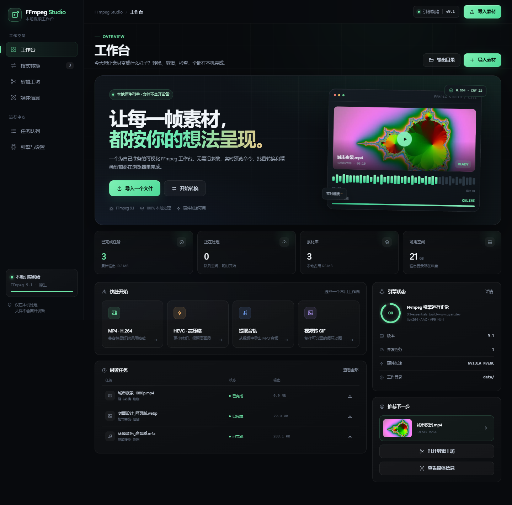

# FFmpeg Studio

**A local-first, native FFmpeg GUI for Windows x64 · v1.0.1**

Drop video, audio, and image files into a browser window to convert, trim, crop, change speed, adjust color, add a text watermark, make GIFs, and inspect media metadata. Everything runs on the local machine with native FFmpeg 9.1. Files never leave the device.

> FFmpeg Studio is an independent project. It is not affiliated with, endorsed by, or sponsored by the FFmpeg project or gyan.dev. "FFmpeg" is a trademark of Fabrice Bellard and is used only to describe the bundled engine.



## Download

Get the latest build from [Releases](../../releases/latest):

| File | Description |
| --- | --- |
| `FFmpegStudio-1.0.1-win64.zip` | Complete portable directory build with Node.js and FFmpeg |
| `FFmpegStudio-1.0.1-win64.zip.sha256` | Directory ZIP checksum |
| `FFmpegStudio-Portable-1.0.1.exe` | Single-file portable launcher; extracts on first run |
| `FFmpegStudio-Portable-1.0.1.exe.sha256` | Portable EXE checksum |
| `ffmpeg-9.1-source.tar.gz` | FFmpeg source snapshot from git tag `n9.1` (GPLv3 compliance) |

Verify before running:

```powershell
Get-FileHash .\FFmpegStudio-1.0.1-win64.zip -Algorithm SHA256
```

Compare the result with the published `.sha256` file.

## Quick start

1. Extract the ZIP into a writable folder.
2. Double-click `Start.bat`.
3. The browser opens `http://127.0.0.1:4318` (the port moves up automatically if 4318 is busy).
4. To stop, double-click `Stop.bat` or close the `FFmpeg Studio Server` window.

No Node.js, FFmpeg, or browser extension installation is required. No administrator rights. The server binds to `127.0.0.1` only.

### Single-file version (optional)

Download **`FFmpegStudio-Portable-1.0.1.exe`** and double-click it. On first launch it extracts to `%LOCALAPPDATA%\FFmpegStudio\app-1.0.1`; data lives in `%LOCALAPPDATA%\FFmpegStudio\data`. A tray icon stays running after the browser closes; use its **Exit FFmpeg Studio** menu item to stop the server. The EXE is not code-signed, so SmartScreen may warn; verify the SHA-256 first.

### Requirements

- Windows 10 (1809+) or Windows 11, 64-bit
- About 400 MB of free disk space, plus room for outputs
- Microsoft Edge, Google Chrome, or another modern Chromium browser

## Features

- Convert video to MP4 / MKV / WebM / MOV / GIF
- Extract audio to MP3 / M4A / WAV / FLAC / OPUS
- Export images to JPG / PNG / WEBP
- H.264, H.265, AV1, VP9, stream copy, CRF or bitrate, presets, resolution, frame rate
- Batch queue with progress, speed, ETA, cancellation, logs, and output download
- Trim, crop, scale, rotate, flip, color adjustments, denoise, sharpen, speed 0.25x–4x
- Volume, fade in/out, and Chinese text watermarks
- ffprobe media inspection with raw JSON
- Engine page with encoder/filter detection and a one-click H.264 + AAC self-test

## Build from source

Requires Windows and PowerShell 5.1+, with internet access for the first dependency download:

```powershell
git clone <your-repo-url> ffmpeg-studio
cd ffmpeg-studio
powershell -ExecutionPolicy Bypass -File .\scripts\setup-deps.ps1
.\Start.bat
```

`setup-deps.ps1` downloads pinned Node.js 24.19.0 and FFmpeg 9.1 builds, verifies SHA-256, and copies only the required binaries into `runtime\` and `ffmpeg\bin\`. It does not change the system PATH.

Build the release ZIP:

```powershell
powershell -ExecutionPolicy Bypass -File .\scripts\build-release.ps1
```

Build the single-file EXE (launcher source is in `portable/Launcher.cs`):

```powershell
powershell -ExecutionPolicy Bypass -File .\portable\build-portable.ps1
```

Run the smoke test:

```powershell
powershell -ExecutionPolicy Bypass -File .\scripts\smoke-test.ps1
```

## Security

- The HTTP server listens on `127.0.0.1` only and has no authentication; do not expose it through a reverse proxy, port forward, or tunnel.
- Uploads are restricted to a media-extension allowlist, stored under random UUID names, and served with a restrictive Content Security Policy.
- FFmpeg runs as a separate process with the current user's privileges. Treat untrusted media as potentially dangerous and keep FFmpeg updated.
- The release is not code-signed. Verify the SHA-256 checksum and download only from this repository's Releases.

Please report security issues privately as described in [SECURITY.md](SECURITY.md).

## Privacy

No uploads, no cloud APIs, no telemetry, no CDN, no remote fonts. Media and job history stay in the local `data/` directory.

## License

Application code is MIT licensed. FFmpeg is GPLv3; Node.js is MIT. See [LICENSE](LICENSE) and [THIRD_PARTY_NOTICES.md](THIRD_PARTY_NOTICES.md).

The release includes `ffmpeg-9.1-source.tar.gz`, a source snapshot generated from the official FFmpeg git tag `n9.1`, and links to the official release tarball, exact build scripts, and build configuration.

## Credits

- [FFmpeg](https://ffmpeg.org/) — GPLv3
- [Node.js](https://nodejs.org/) — MIT
- [dinoosauro/ffmpeg-web](https://github.com/dinoosauro/ffmpeg-web) — MIT; UI/interaction inspiration only, no ffmpeg.wasm runtime code used

---

中文说明见 [README.md](README.md)。
