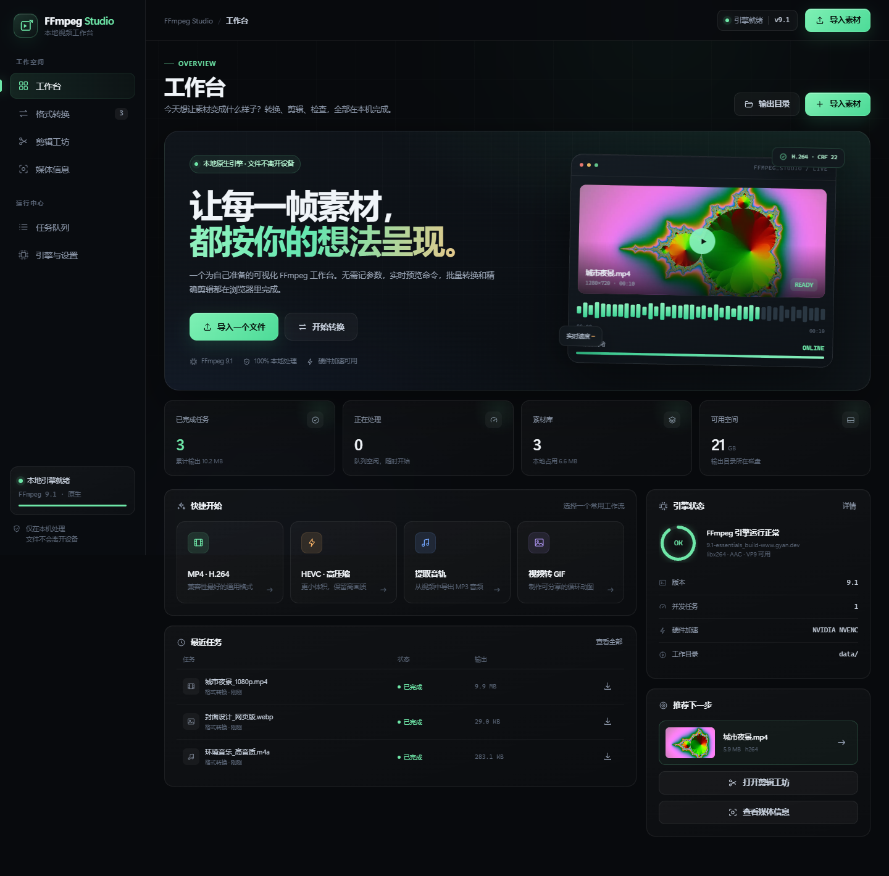
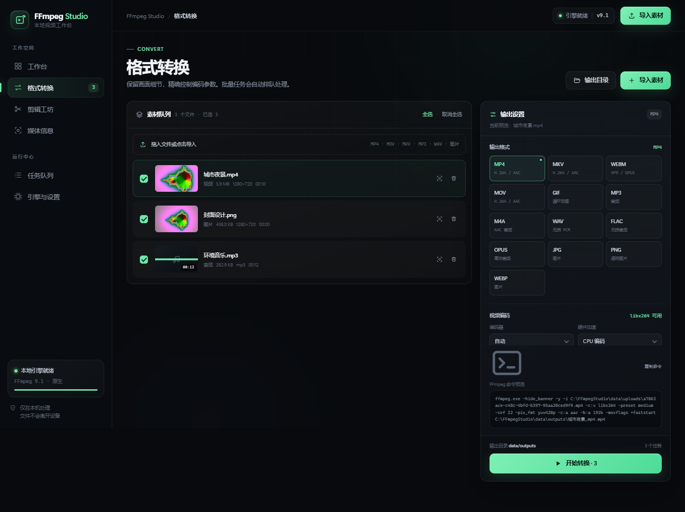
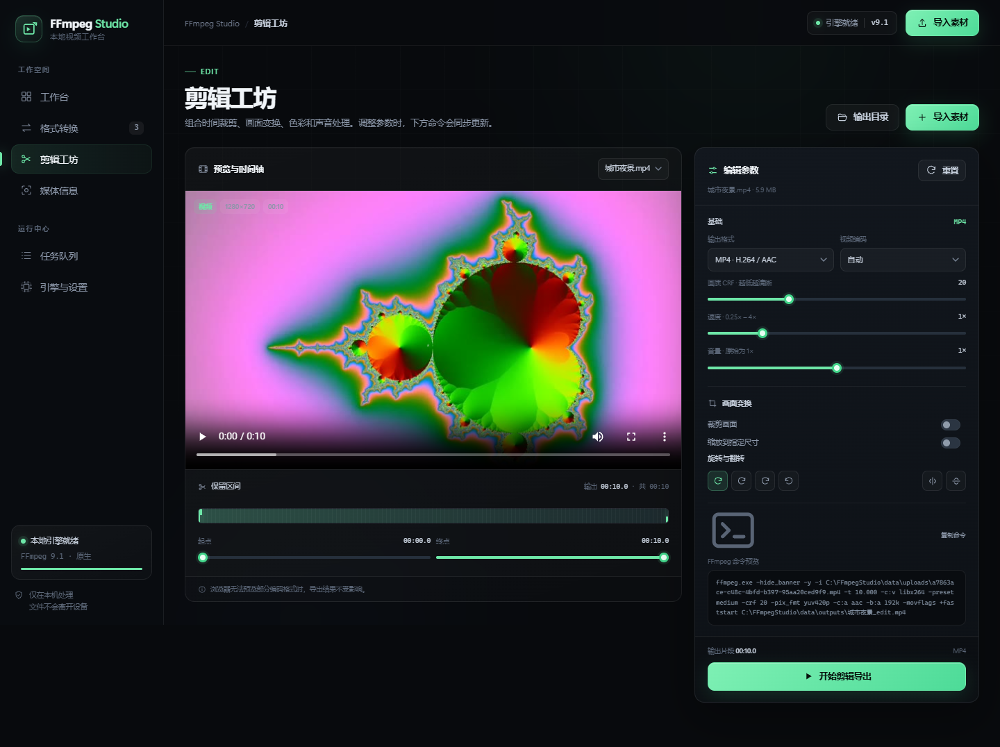
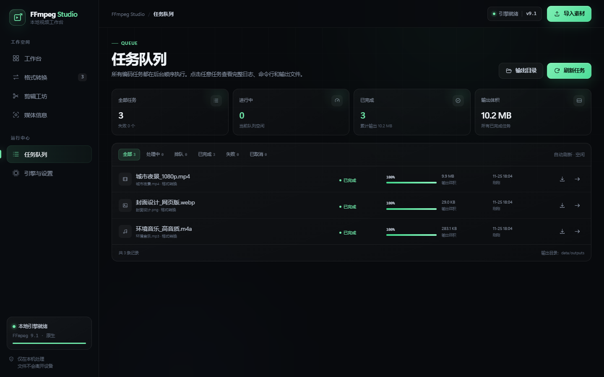
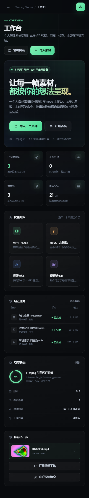

# FFmpeg Studio

**本地原生 FFmpeg 可视化工作台** · Windows 10/11 x64 · v1.0.1

把视频、音频和图片拖进浏览器，就能完成格式转换、剪辑、裁剪、变速、调色、加水印、GIF 制作和媒体信息检查。所有处理都由本机 FFmpeg 9.1 完成，文件不会上传到任何服务器。

> FFmpeg Studio 是独立项目，与 FFmpeg 官方、gyan.dev 没有隶属关系，也未获得其背书。“FFmpeg”是 Fabrice Bellard 的商标，此处仅用于说明本软件调用 FFmpeg。



| 格式转换 | 剪辑工坊 |
| --- | --- |
|  |  |

| 任务队列 | 移动端 |
| --- | --- |
|  |  |

> 截图中的素材、任务和文件名均为合成测试数据；首次启动是空白工作区。

---

## 下载与开始

从 [Releases](../../releases/latest) 下载：

| 文件 | 说明 |
| --- | --- |
| `FFmpegStudio-1.0.1-win64.zip` | 完整目录版，含 Node.js 与 FFmpeg，解压即用 |
| `FFmpegStudio-1.0.1-win64.zip.sha256` | 目录版 ZIP 的 SHA-256 校验值 |
| `FFmpegStudio-Portable-1.0.1.exe` | 单文件便携版，双击启动，首次运行自动解压 |
| `FFmpegStudio-Portable-1.0.1.exe.sha256` | 单文件 EXE 的 SHA-256 校验值 |
| `ffmpeg-9.1-source.tar.gz` | 从 git tag `n9.1` 生成的 FFmpeg 源码快照（GPLv3 合规） |

校验下载：

```powershell
Get-FileHash .\FFmpegStudio-1.0.1-win64.zip -Algorithm SHA256
```

应得到与 Release 中 `FFmpegStudio-1.0.1-win64.zip.sha256` 文件一致的 SHA-256。

然后：

1. 把 ZIP 完整解压到一个有写入权限的目录（不要在 ZIP 预览窗口里直接运行）。
2. 双击 **`Start.bat`**。
3. 浏览器自动打开 `http://127.0.0.1:4318`。端口被占用时会自动顺延。
4. 停止服务：双击 **`Stop.bat`**，或关闭任务栏里最小化的 `FFmpeg Studio Server` 窗口。

不需要安装 Node.js、FFmpeg 或浏览器插件，不需要管理员权限。程序只监听 `127.0.0.1`，不会接收局域网或公网连接。

### 单文件版（可选）

不想解压目录时，下载 **`FFmpegStudio-Portable-1.0.1.exe`**，双击即可：

1. 首次启动会显示“正在解压内置组件”，约 5–10 秒。
2. 程序解压到 `%LOCALAPPDATA%\FFmpegStudio\app-1.0.1`，数据保存在 `%LOCALAPPDATA%\FFmpegStudio\data`。
3. 启动后浏览器自动打开，右下角出现托盘图标。
4. 关闭浏览器不会退出程序；请右键托盘图标选择“退出 FFmpeg Studio”。

单文件版未做商业代码签名，SmartScreen 可能提示；请先校验 SHA-256。它使用 Windows 10/11 自带的 .NET Framework 4.8，不需要额外安装运行时。

### 系统要求

- Windows 10（1809 或更高）/ Windows 11，64 位
- 约 400 MB 磁盘空间；处理媒体时还需要输出文件的额外空间
- Microsoft Edge、Google Chrome 或其他现代 Chromium 浏览器
- 首次解压后无需联网

---

## 功能

### 格式转换
- 视频：MP4 / MKV / WebM / MOV / GIF
- 音频：MP3 / M4A / WAV / FLAC / OPUS
- 图片：JPG / PNG / WEBP
- H.264、H.265、AV1、VP9 编码，也可直接复制视频流
- CRF 恒定质量或目标码率、编码预设、分辨率、帧率、音频码率/采样率/声道
- NVIDIA NVENC / Intel Quick Sync / AMD AMF 编译支持检测
- 批量勾选、逐个排队；每个任务独立进度、速度、ETA、日志
- 输出文件名可自定义；重名自动递增，不覆盖已有文件

### 剪辑工坊
- 精确起点/终点区间，实时显示输出片段时长
- 画面裁剪、缩放、旋转 90°/180°/270°、水平/垂直翻转
- 亮度、对比度、饱和度、降噪、锐化
- 变速 0.25×–4×（视频和音频同步处理）
- 音量、淡入淡出
- 中文文字水印（位置、字号、透明度）
- 视频、音频、GIF、单帧图片多种导出目标

### 媒体信息
- 由 ffprobe 读取完整容器与所有流
- 时长、大小、码率、分辨率、帧率、编码、采样率、声道、元数据标签
- 视频/音频/图片预览、原文件下载、完整原始 JSON 复制

### 任务队列
- 实时进度、速度、帧率、ETA
- 查看完整 FFmpeg 命令和运行日志
- 取消排队中/处理中任务、下载输出、在资源管理器中定位文件、删除任务记录
- 重启应用后历史任务仍保留；中断任务会标记为失败

### 引擎与设置
- FFmpeg / ffprobe 版本、构建信息、二进制路径
- 编码器矩阵、滤镜数量、硬件接口检测
- 一键运行 H.264 + AAC 自检，验证编码链路
- 磁盘剩余空间、Node 版本、并发数和运行时长
- 打开输出目录、访问官方文档和许可信息

---

## 支持的文件

**输入**：MP4、MKV、WebM、MOV、AVI、M4V、FLV、WMV、TS、M2TS、MPEG、3GP、OGV、MP3、WAV、FLAC、M4A、AAC、OGG、OPUS、WMA、AIFF、JPG、PNG、WEBP、GIF、BMP、TIFF、AVIF 等。

**输出**：MP4、MKV、WebM、MOV、GIF、MP3、M4A、WAV、FLAC、OPUS、JPG、PNG、WEBP。

具体可用编码取决于内置 FFmpeg 的编译选项；“引擎与设置”页面可以看到完整编码器列表。

---

## 使用说明

### 导入
把文件拖入窗口任意位置，或点击右上角“导入素材”。从工作台导入后会自动进入“格式转换”页面；也可以直接到“剪辑工坊”或“媒体信息”页面切换素材。

### 转换
1. 在左侧素材队列勾选要处理的文件（可多选）。
2. 在右侧选择输出格式和参数。
3. 底部会实时生成 FFmpeg 命令预览，可以复制。
4. 点击“开始转换”，任务进入队列；程序会自动跳到任务队列。

### 剪辑
1. 在顶部选择素材。
2. 拖动起点/终点滑块，或直接设置区间。
3. 按需设置裁剪、缩放、旋转、调色、变速、音量、淡入淡出和水印。
4. 点击“开始剪辑导出”，在任务队列查看结果。

### 任务与输出
- 上传的源文件：`data/uploads/`
- 导出文件：`data/outputs/`
- 任务记录：`data/jobs/`
- 缩略图缓存：`data/thumbs/`

这些目录都在软件目录内，可以整体备份或迁移。删除软件目录前，请先备份 `data/outputs/`。

---

## 从源码运行

需要 Windows、PowerShell 5.1+，以及首次联网下载依赖：

```powershell
git clone <your-repo-url> ffmpeg-studio
cd ffmpeg-studio
powershell -ExecutionPolicy Bypass -File .\scripts\setup-deps.ps1
.\Start.bat
```

`setup-deps.ps1` 会下载固定版本的 Node.js 24.19.0 和 FFmpeg 9.1，校验 SHA-256 后放入 `runtime/` 和 `ffmpeg/bin/`。脚本不会修改系统 PATH，也不会安装全局组件。

如果你已经装好 Node.js 20+，也可以直接：

```powershell
node .\app\server.js --open
```

### 构建发布包

```powershell
powershell -ExecutionPolicy Bypass -File .\scripts\build-release.ps1
```

输出：

```text
dist\FFmpegStudio-1.0.1-win64.zip
dist\FFmpegStudio-1.0.1-win64.zip.sha256
dist\FFmpegStudio-Portable-1.0.1.exe
dist\FFmpegStudio-Portable-1.0.1.exe.sha256
```

构建单文件版：

```powershell
powershell -ExecutionPolicy Bypass -File .\portable\build-portable.ps1
```

启动器源码在 `portable/Launcher.cs`，构建脚本会重新生成净化后的 payload 并嵌入 EXE。

### 冒烟测试

```powershell
powershell -ExecutionPolicy Bypass -File .\scripts\smoke-test.ps1
```

测试会启动本地服务、检查 `/api/health`、运行一次 H.264 + AAC 自检，然后关闭服务。详细测试说明见 [docs/TESTING.md](docs/TESTING.md)。

---

## 目录结构

```text
ffmpeg-studio/
├─ Start.bat                 启动服务并打开浏览器
├─ Stop.bat                  停止本地服务
├─ app/
│  ├─ server.js              零依赖 Node 服务端 / FFmpeg 调度器
│  └─ public/                前端页面、样式、脚本、图标
├─ ffmpeg/
│  ├─ bin/                   运行时放入 ffmpeg.exe / ffprobe.exe
│  ├─ LICENSE                FFmpeg GPLv3 许可
│  ├─ README.txt             gyan.dev 构建配置
│  └─ SOURCE.txt             对应源码与构建来源
├─ runtime/
│  ├─ node.exe               运行时放入 Node.js 24.19.0
│  └─ LICENSE                Node.js MIT 许可
├─ data/                     运行时数据（源文件、输出、任务、缓存）
├─ docs/                     截图与测试说明
├─ licenses/                 第三方许可
├─ scripts/
│  ├─ setup-deps.ps1         下载并校验 Node.js / FFmpeg
│  ├─ build-release.ps1      生成目录版 ZIP 与校验文件
│  ├─ smoke-test.ps1         本地冒烟测试
│  └─ stop-server.ps1        安全停止本地服务
├─ portable/
│  ├─ Launcher.cs            C# 单文件启动器源码
│  ├─ build-portable.ps1     构建单文件 EXE
│  └─ app.ico                应用与托盘图标
├─ THIRD_PARTY_NOTICES.md
├─ SECURITY.md
├─ CHANGELOG.md
├─ BUILD_INFO.txt
├─ VERSION.txt
├─ package.json
├─ LICENSE
└─ README.md
```

---

## 配置

可在启动前设置环境变量：

| 变量 | 默认值 | 说明 |
|---|---|---|
| `PORT` | `4318` | 监听端口，被占用时自动递增 |
| `FFSTUDIO_DATA` | `./data` | 数据目录 |
| `FFMPEG_DIR` | `./ffmpeg/bin` | FFmpeg 二进制目录 |
| `FFSTUDIO_CONCURRENCY` | `1` | 同时运行的任务数（1–3） |
| `FFSTUDIO_MAX_UPLOAD` | `21474836480` | 单文件上限（字节） |

---

## 安全模型

- 服务只绑定 `127.0.0.1`，没有账号系统，也没有远程访问接口。
- **不要**用反向代理、端口转发或内网穿透把服务暴露到局域网/公网；这属于不受支持的使用方式。
- 上传只接受白名单内的媒体扩展名，文件名会被净化，文件以随机 UUID 保存。
- 静态文件目录做了路径穿越检查；页面设置了 CSP、`nosniff` 和 `frame-ancestors 'none'`。
- FFmpeg 以当前用户权限运行，并作为独立进程调用。恶意媒体文件仍可能触发 FFmpeg 自身漏洞；请只处理可信来源的文件，并保持 FFmpeg 更新。
- 发布包没有商业代码签名。Windows SmartScreen 或杀毒软件可能对“带 ffmpeg.exe 的压缩包”提示；请用 SHA-256 校验，并从本仓库 Releases 下载。

安全问题请按 [SECURITY.md](SECURITY.md) 私下报告，不要先开公开 Issue。

---

## 隐私

- 不上传文件，不调用云端 API，不加载外部字体、脚本或统计代码。
- 所有媒体文件和任务记录都保存在本机 `data/`。
- 页面中的 FFmpeg 官网、GitHub 等链接需要用户主动点击才会访问外网。
- 删除素材会删除 `data/uploads/` 中对应的源文件，但不会删除已经导出的结果。

---

## 测试与验证

本版本在 Windows 11（26100）x64 上完成：

- 22 项 API 集成检查（9.0.2 基线，2026-10-26）：上传、探测、缩略图、HTTP Range、格式校验、M4A/MP3/WEBM/GIF/WEBP 转换、剪辑、命令预览、下载、取消、自检、404、路径穿越拦截。
- 浏览器端到端检查：文件上传、参数绑定、任务提交、下载、日志、中文水印、媒体信息、自检、移动端布局、实时进度和 UI 取消。
- 2026-11-25 在 FFmpeg 9.1 上重新执行：健康检查、系统信息、三种媒体上传、MP4/M4A/WEBP 转换、ffprobe 复核、自检、发布 ZIP 全新目录解压运行。
- 所有输出均用 ffprobe 复核容器、编码、分辨率、时长和流结构。

测试方法和结果见 [docs/TESTING.md](docs/TESTING.md)。

---

## FFmpeg 版本与许可

内置 **FFmpeg 9.1**（2026-11-20 发布）essentials build，来源：

- 构建：gyan.dev `9.1-essentials_build`
- 许可：GPLv3（构建含 `--enable-gpl --enable-version3`）
- 发布页：<https://github.com/GyanD/codexffmpeg/releases/tag/9.1>
- 官方源码：<https://ffmpeg.org/releases/ffmpeg-9.1.tar.xz>
- 官方签名：<https://ffmpeg.org/releases/ffmpeg-9.1.tar.xz.asc>
- 源码快照（Release 资产）：`ffmpeg-9.1-source.tar.gz`（git tag `n9.1`）

Release 中同时提供 `ffmpeg-9.1-source.tar.gz`，作为 GPLv3 对应源码；其内容取自 FFmpeg 官方 git tag `n9.1`。FFmpeg 二进制未修改，仅通过命令行调用；应用代码没有链接 FFmpeg 库。

### 更新 FFmpeg

下载更新版本的 Windows x64 essentials/full 构建，替换：

```text
ffmpeg/bin/ffmpeg.exe
ffmpeg/bin/ffprobe.exe
```

保留新的 `ffmpeg/LICENSE` 和 `ffmpeg/README.txt`，并同步更新 `BUILD_INFO.txt`。软件启动时会自动重新读取版本、编码器和滤镜列表；替换后请在“引擎与设置”里运行一次自检。

---

## 常见问题

**浏览器没有自动打开？**  
手动访问 `http://127.0.0.1:4318`。若端口被占用，查看 `data/server.json` 里的 `port`，或关闭占用端口的程序。

**提示 FFmpeg 不可用？**  
确认 `ffmpeg/bin/ffmpeg.exe` 和 `ffmpeg/bin/ffprobe.exe` 存在，且没有被杀毒软件隔离。可在“引擎与设置”页面查看路径和版本。

**硬件加速失败？**  
“可用”只代表 FFmpeg 编译了对应接口，实际还取决于显卡、驱动和会话。把“硬件加速”切回“CPU 编码”即可。默认使用 CPU，最稳定。

**输出文件在哪里？**  
`data/outputs/`。任务完成后点击“打开文件夹”，或点击页面上的“输出目录”。

**能处理多大的文件？**  
默认单文件上限 20 GB；受磁盘空间和内存影响。大文件建议使用 MP4/MKV 等常见容器。

**可以移动软件目录吗？**  
可以，整个 `FFmpegStudio` 目录一起移动即可。不要只移动 `Start.bat` 或单个 exe。

**为什么没有安装程序？**  
这是便携应用：目录版解压后运行 `Start.bat`；单文件版双击 EXE。两者都不写注册表、不装服务。目录版删除目录即可卸载；单文件版先从托盘退出，再删除 `%LOCALAPPDATA%\FFmpegStudio` 和 EXE（先备份 `data/outputs/`）。

---

## 第三方与致谢

- **FFmpeg** — <https://ffmpeg.org/> · GPLv3 · 内置 9.1 essentials build
- **Node.js** — <https://nodejs.org/> · MIT · 内置 24.19.0 win-x64
- **dinoosauro/ffmpeg-web** — <https://github.com/dinoosauro/ffmpeg-web> · MIT
  - 本项目以其功能组织和可视化交互模式为设计参考，重新实现为原生 FFmpeg 本地 Web 应用；没有使用其 ffmpeg.wasm 运行时代码。
- 界面图标为项目内手写 SVG；界面使用系统本地字体，不捆绑字体文件。

完整许可见 [THIRD_PARTY_NOTICES.md](THIRD_PARTY_NOTICES.md)、[LICENSE](LICENSE)、`ffmpeg/LICENSE`、`runtime/LICENSE`。

---

## 许可

应用代码以 **MIT** 许可发布，版权归 FFmpeg Studio contributors。内置 FFmpeg 为 **GPLv3**，Node.js 为 **MIT**，分别遵循各自许可。

本项目按“现状”提供，不附带任何明示或暗示担保。处理重要素材前请自行备份。

---

## English

FFmpeg Studio is a local-first, native FFmpeg GUI for Windows x64. It runs a zero-dependency Node.js server on `127.0.0.1` and opens a browser UI; media never leaves the machine.

Download the release ZIP, extract it, and run `Start.bat`. Or use the single-file `FFmpegStudio-Portable-1.0.1.exe`. No Node.js, FFmpeg, or browser extension installation is required. See [README.en.md](README.en.md) for the English guide, or [Releases](../../releases/latest) for the latest build.
